# Insurance-RAG

Insurance-RAG is a retrieval-augmented generation system for querying, analyzing, and comparing insurance policy documents. It combines layout-preserving document extraction, dual-track hybrid retrieval, cross-encoder reranking, and structured schema validation.

## System Architecture

Insurance policies are legal contracts with interlocking dependencies, including definitions, waiting periods, sub-limits, general exclusions, and conditional riders. Naive chunking and single-vector similarity search frequently miss relevant exclusion clauses or misattribute definitions.

The system addresses these structural constraints through a dual-track ingestion and retrieval pipeline:

```mermaid
graph TD
    subgraph Ingestion["1. Document Ingestion Pipeline"]
        PDF["Policy PDF"] --> Extractor["PyMuPDF4LLM Markdown Extractor"]
        Extractor --> Cleaner["Markdown Layout Cleaner"]
        Cleaner --> Chunker["MarkdownHierarchicalChunker"]
        Chunker --> VectorStore["Dense Vector Store: Chroma / Pinecone"]
        Chunker --> LexicalStore["Lexical BM25 Store: RediSearch / RAM"]
    end

    subgraph QueryFlow["2. Hybrid Retrieval and Adjudication"]
        UserQuery["User Inquiry"] --> Rewriter["Planner LLM / Query Rewriter"]
        Rewriter -->|Semantic Search| VectorSearch["Dense Vector Search: bge-large-en-v1.5"]
        Rewriter -->|Exact Match| LexicalSearch["BM25 Lexical Search: RediSearch"]
        
        VectorSearch --> RRF["Reciprocal Rank Fusion: RRF"]
        LexicalSearch --> RRF
        
        RRF --> Reranker["Cross-Encoder Reranker: bge-reranker-v2-m3"]
        Reranker --> LLM["Inference Generator: Gemini / Groq"]
        LLM --> Formatter["Pydantic Structured Output Formatter"]
        Formatter --> Response["Advisory and Adjudication Report"]
    end
```



For the mathematical formulation of reciprocal rank fusion and architectural trade-offs, see the [Architecture Guide](docs/architecture.md).

## Key Capabilities

* Adjudication hierarchy: Enforces precedence across specific exceptions, general exclusions, explicit inclusions, and policy silence.
* Structured output: Uses Pydantic models (`SinglePolicyResponse`, `ComparePolicyResponse`) to ensure consistent schemas without regex post-processing.
* Cross-policy analysis: Evaluates coverage differences, sub-limits, and waiting periods across distinct policy contracts.
* Storage and model backends:
  * Vector storage: Chroma or Pinecone.
  * Lexical retrieval: Redis (RediSearch) or in-memory BM25.
  * Inference providers: Google Gemini or Groq (Llama 3.3).
* Pre-warmed lifespan state: Models and database client connection pools are initialized once at server startup and reused across requests.

## Quickstart

### Option A: Docker Compose

Deploys the FastAPI service, Streamlit interface, and Redis Stack instance:

```bash
git clone https://github.com/falcon978/Insurance-RAG.git
cd Insurance-RAG

cp .env.example .env
docker compose up --build
```

Service endpoints:
* API Documentation: [http://localhost:8000/docs](http://localhost:8000/docs)
* Web Interface: [http://localhost:8501](http://localhost:8501)

### Option B: Local Installation

Requires Python 3.12 or higher:

```bash
python3.12 -m venv .venv
source .venv/bin/activate

pip install -e ".[backend,ui]"

# Start Redis for lexical indexing (optional if using LEXICAL_DB_TYPE=ram)
docker run -d --name redis-stack -p 6379:6379 redis/redis-stack-server:latest

# Run services
uvicorn main:app --port 8000 --reload
streamlit run app.py
```

Environment variable reference is documented in [.env.example](.env.example).

## Repository Structure

```text
├── api/                   # FastAPI routing, dependencies, and exception handlers
│   ├── routers/           # Query and administrative endpoints
│   ├── dependencies.py    # Dependency injection providers
│   └── exception_handlers.py # Custom domain exception mapping
├── rag/                   # Core RAG engine, factories, reranker, prompts, and schemas
├── rag_ingestion/         # Document extraction, hierarchical chunking, and indexing
├── evaluations/           # DeepEval benchmark suites, dataset, and judge wrapper
├── docs/                  # System architecture, API, and evaluation documentation
├── main.py                # Application entrypoint and lifespan management
├── app.py                 # Streamlit interface
├── docker-compose.yml     # Multi-container orchestration
└── pyproject.toml         # Packaging and dependency configuration
```

## API Overview

| Method | Endpoint | Description |
| :--- | :--- | :--- |
| `POST` | `/api/v1/query/single` | Queries a single policy collection with optional conversation history. |
| `POST` | `/api/v1/query/compare` | Compares coverage between two distinct policy collections. |
| `POST` | `/api/v1/admin/ingest/file` | Ingests a policy PDF via multipart upload. |
| `POST` | `/api/v1/admin/ingest/url` | Downloads and indexes a policy PDF from a URL. |
| `GET` | `/api/v1/admin/collections` | Lists all indexed collections across the vector store. |
| `DELETE` | `/api/v1/admin/collections/{name}` | Drops a collection from vector and lexical stores. |

Complete request and response specifications are available in the [API Reference](docs/api.md).

## Evaluation

Automated evaluation is implemented with [DeepEval](https://github.com/confident-ai/deepeval):

* Correctness and faithfulness: Assesses verdict accuracy and verifies citations against retrieved context.
* Contextual precision: Measures ranking quality produced by the cross-encoder reranker.
* Contextual recall: Verifies hybrid retrieval coverage against ground-truth policy clauses.

To execute the test suite:

```bash
pip install -e ".[dev]"
pytest evaluations/test_cases/test_standard_rag_metrics.py -v
```

Judge configuration and benchmark methodology are documented in the [Evaluation Guide](docs/evaluation.md).

## Documentation

* [Architecture Guide](docs/architecture.md): Pipeline stages, scoring formulations, and operational trade-offs.
* [Evaluation Guide](docs/evaluation.md): Benchmark metrics, test datasets, and LLM judge configurations.
* [API Reference](docs/api.md): Endpoint specifications, request and response models, and cURL examples.
