# Architecture and System Design

This document details the internal design, mathematical formulations, and engineering trade-offs of the Insurance RAG system.

## 1. End-to-End Pipeline

Insurance policies are legal contracts with interlocking dependencies, including definitions, waiting periods, sub-limits, general exclusions, and specific condition riders. The system avoids naive chunking and single-vector similarity search, employing a dual-track hybrid pipeline with multi-stage refinement.

```mermaid
graph TD
    subgraph Ingestion["1. Document Ingestion Pipeline"]
        PDF["Policy PDF"] --> Extractor["PyMuPDF4LLM Markdown Extractor"]
        Extractor --> Cleaner["Markdown Layout Cleaner"]
        Cleaner --> Chunker["MarkdownHierarchicalChunker"]
        Chunker --> VectorStore["Dense Vector Store: Chroma / Pinecone"]
        Chunker --> LexicalStore["Lexical BM25 Store: RediSearch / RAM"]
    end

    subgraph QueryFlow["2. Hybrid Retrieval and Adjudication"]
        UserQuery["User Inquiry"] --> Rewriter["Planner LLM / Query Rewriter"]
        Rewriter -->|Semantic Search| VectorSearch["Dense Vector Search: bge-large-en-v1.5"]
        Rewriter -->|Exact Match| LexicalSearch["BM25 Lexical Search: RediSearch"]
        
        VectorSearch --> RRF["Reciprocal Rank Fusion: RRF"]
        LexicalSearch --> RRF
        
        RRF --> Reranker["Cross-Encoder Reranker: bge-reranker-v2-m3"]
        Reranker --> LLM["Inference Generator: Gemini / Groq"]
        LLM --> Formatter["Pydantic Structured Output Formatter"]
        Formatter --> Response["Advisory and Adjudication Report"]
    end
```

### Stage 1: Document Ingestion (`rag_ingestion/`)
* Layout-Preserving Extraction (`extractor.py`): Uses PyMuPDF4LLM to convert visual tables, numbered clauses, and headers into GitHub-flavored Markdown.
* Hierarchical Chunking (`chunker.py`): Splits text along legal section headers (`#`, `##`, `###`) rather than arbitrary token boundaries. Chunks retain metadata: `section`, `page_start`, `page_end`, and a deterministic `chunk_id`.
* Dual Indexing (`indexer.py`): Chunks are embedded with `BAAI/bge-large-en-v1.5` (L2-normalized) into the vector store, while simultaneously indexed in RediSearch (or local serialized BM25).

### Stage 2: Query Translation and Intent Rewriting (`rag/query_rewriter.py`)
User questions frequently use lay phrasing (such as *"Does this pay for knee surgery?"*) rather than contractual phrasing (such as *"arthroscopic meniscectomy"*).
A planner LLM translates the query into an `OptimizedSearchQuery` schema:
* `canonical_query`: Normalized policy question.
* `medical_terms`: Clinical, anatomical, and surgical keywords.
* `expanded_terms`: Industry concepts (such as *"pre-existing disease"*, *"day care treatment"*).
* `exclusion_terms`: Common exclusion keywords to pull applicable caveats.
* `policy_sections`: Targeted contract sections.

### Stage 3: Dual-Track Retrieval and Reciprocal Rank Fusion (`rag/retriever.py`, `rag/utils.py`)
1. Semantic Search: Dense vector search using `BAAI/bge-large-en-v1.5`.
2. Lexical Search: BM25 full-text match over RediSearch or memory cache.
3. Rank-Based Mathematical Fusion (RRF):
   Cosine distance and BM25 log-odds scores exhibit differing distributions and cannot be normalized via min-max scaling. Results are combined through weighted Reciprocal Rank Fusion:
   $$RRF\_Score(d) = w_{semantic} \cdot \frac{1}{k + rank_{semantic}(d)} + w_{lexical} \cdot \frac{1}{k + rank_{lexical}(d)}$$
   Default parameters: $k = 60$, $w_{semantic} = 0.5$, $w_{lexical} = 0.5$.

### Stage 4: Cross-Encoder Reranking (`rag/rerankers.py`)
Top candidate chunks ($K=15$) are processed by a cross-encoder (`BAAI/bge-reranker-v2-m3` or `ms-marco-MiniLM-L-12-v2`).
* Computes bidirectional cross-attention across concatenated query-intent tokens and each candidate chunk.
* Retains the top $N$ most contextually relevant chunks ($N=5$), reducing context window size and mitigating attention degradation.

### Stage 5: Structured Adjudication (`rag/generator.py`, `rag/llm_schemas.py`)
Generation uses strict Pydantic models to separate definitive claims adjudication from advisory summaries:
* Phase 1: Authoritative Legal Adjudication
  * `coverage_status`: `YES`, `NO`, or `CONDITIONAL`.
  * `primary_clause`: Dominant contractual clause determining the status.
  * `specific_exception_found`: Whether an active exception or exclusion applies.
  * `gap_analysis`: Missing policy documentation or unverified riders.
  * `decision_confidence`: `HIGH`, `MEDIUM`, or `LOW`.
  * `document_completeness`: `COMPLETE`, `PARTIAL`, or `INSUFFICIENT`.
* Phase 2: Non-Authoritative Advisory Report
  * Executive summary, comparison matrix, detailed analysis, risk disclosures, follow-up questions, and statutory legal disclaimers.

## 2. Engineering Trade-offs and Design Decisions

| Decision Area | Chosen Strategy | Alternative | Rationale and Trade-off |
| :--- | :--- | :--- | :--- |
| Score Fusion | Reciprocal Rank Fusion (RRF) | Min-Max Normalization | RRF is immune to score distribution differences between vector cosine distances and BM25 scores, avoiding manual threshold calibration. |
| Reranking | Cross-Encoder Reranker | Direct LLM Context Injection | Adds approximately 30 to 70 ms CPU latency per query, but measurably improves contextual precision and controls prompt token consumption. |
| Output Parsing | Pydantic Structured Output | Free-form Markdown + Regex | Eliminates regex parse failures and schema deviations while constraining output formatting. |
| Lexical Engine | Redis (RediSearch) | Local RAM Pickle Cache | RediSearch requires an external service but is process-safe for multi-worker production deployments. In-memory caching eliminates dependencies but is restricted to single-process deployments. |

## 3. Concurrency and Operational Safety

> [!WARNING]
> Process Concurrency with Local BM25 Cache:
> When using `LEXICAL_DB_TYPE=ram`, the system caches BM25 indices as disk pickles guarded by an internal `asyncio.Lock()`. This lock is process-local. Running multiple Uvicorn workers (`uvicorn --workers 4`) with `LEXICAL_DB_TYPE=ram` will cause race conditions and file corruption on writes. For multi-worker deployments, set `LEXICAL_DB_TYPE=redis`.

